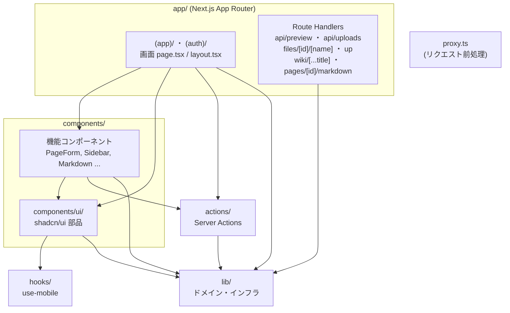
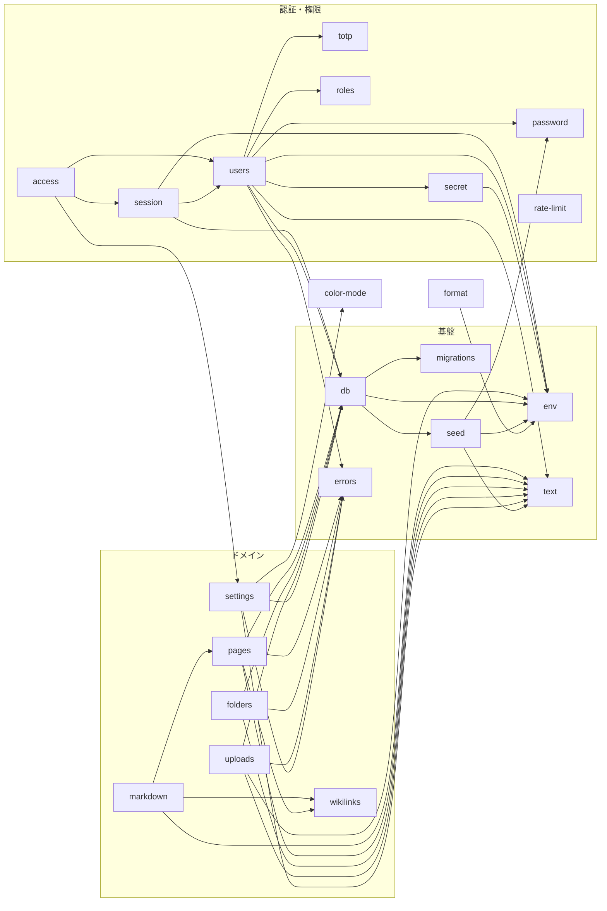

# モジュール構造図

`src/` 配下のモジュールの依存関係です。矢印は「import する側 → される側」。

## レイヤー全体

## lib/ の内部依存

依存のない単独モジュール: `color-mode`, `diff`, `flash`, `form`, `origin`, `params`, `utils`（`cn`）。

## actions/ → lib/

| Action | 主に使う lib |
| --- | --- |
| `auth.ts` | access, session, users, rate-limit, flash, form, text |
| `account.ts` | access, session, users, settings, rate-limit, flash, form, errors |
| `pages.ts` | access, pages, flash, form, errors |
| `folders.ts` | access, folders, flash, form, errors |
| `uploads.ts` | access, uploads, flash |
| `users.ts` | access, users, flash, form, errors |
| `settings.ts` | access, settings, session, users, db, env, flash, form, errors |

## Route Handlers → lib/

| Route | 使う lib |
| --- | --- |
| `api/preview` | markdown, origin, session, users |
| `api/uploads` | uploads, origin, session, users, errors |
| `files/[id]/[name]` | uploads, session, settings |
| `up` | db |
| `(app)/wiki/[...title]` | pages, session, settings |
| `(app)/pages/[id]/markdown` | pages, session, settings |
