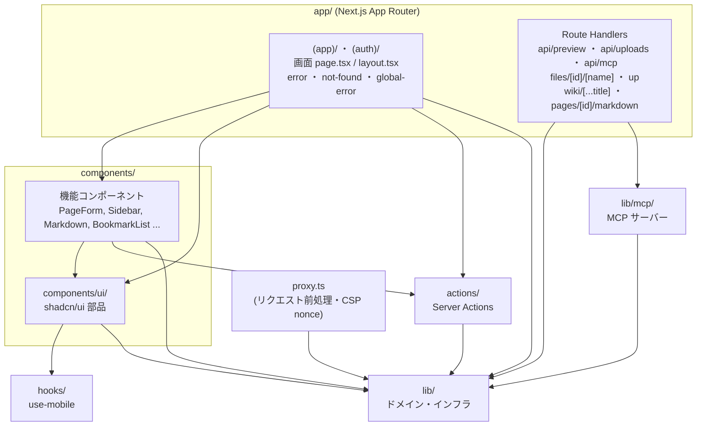
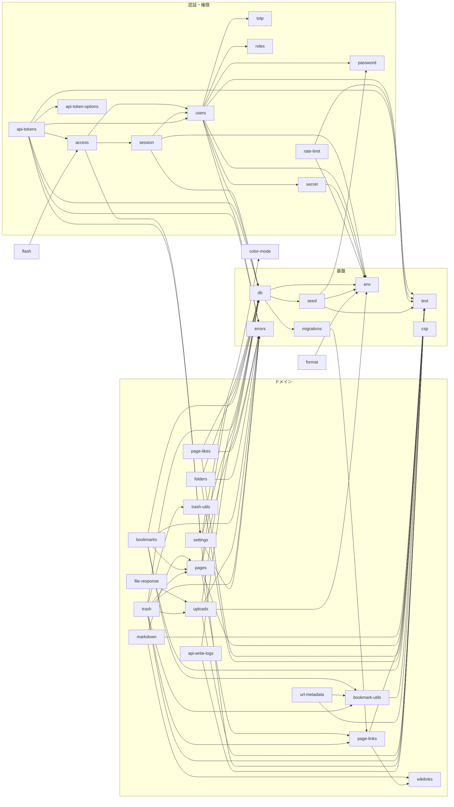
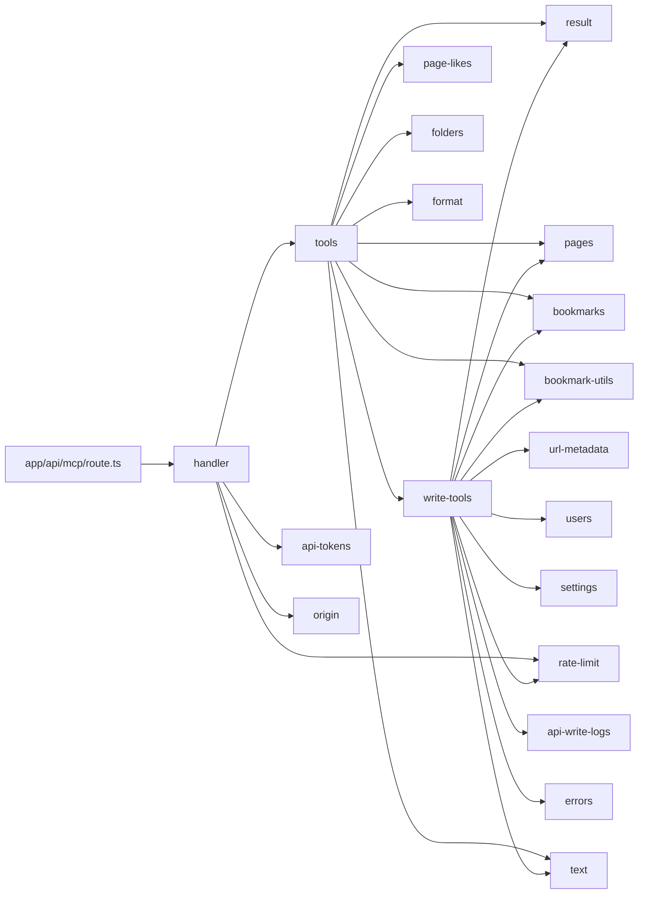

# モジュール構造図

`src/` 配下のモジュールの依存関係です。矢印は「import する側 → される側」。

## レイヤー全体

`stories/` と `components/*.stories.tsx` は Storybook 用で、アプリ本体からは import されません。

## lib/ の内部依存

依存のない単独モジュール: `color-mode`, `csp`, `diff`, `form`, `origin`, `params`, `utils`（`cn`）。

### 検索とバックリンクの索引

- `pages_fts`（FTS5・trigram）は `pages` の外部コンテンツ索引で、トリガーが INSERT/UPDATE/DELETE に追従させる。`pages.searchPages` は 3 文字以上の語を索引で、それより短い語を LIKE で絞り込む。
- `page_links`（リンク元 ID × リンク先タイトルキー）は `page-links.writePageLinks` が作成・保存・復元のたびに書き直す。リンク元の削除は外部キーの CASCADE で消える。`pages.backlinksFor` はここを引く。
- `page_likes`（ページ ID × ユーザー ID、組み合わせは一意）は「いいね!」。`page-likes.setPageLike` は切り替えではなく目標の状態（付ける / 外す）を受け取るので、二重送信しても数がずれない。ページ・ユーザーの削除は外部キーの CASCADE で消え、ゴミ箱へ移すときは退避データに含めて、復元時に（まだ存在するユーザーの分だけ）戻す。いいね!できるのはログインしている人全員で、未ログインの閲覧（ログインなしで閲覧を許可）では数だけを表示する。MCP の `get_page` は数（`likes`）だけを読み取り専用で返す。
- 既存データの取り込みは `migrations.MIGRATION_BACKFILLS` を `db.migrate` がマイグレーション直後に実行する。

## lib/mcp/

## actions/ → lib/

| Action | 主に使う lib |
| --- | --- |
| `auth.ts` | access, session, users, rate-limit, flash, form |
| `account.ts` | access, session, users, settings, rate-limit, flash, form, errors |
| `api-tokens.ts` | access, api-tokens, flash, form, errors |
| `pages.ts` | access, pages, trash, flash, form, errors |
| `likes.ts` | access, page-likes, errors |
| `folders.ts` | access, folders, flash, form, errors |
| `bookmarks.ts` | access, bookmarks, bookmark-utils, url-metadata, trash, rate-limit, flash, form, errors |
| `uploads.ts` | access, uploads, trash, flash, errors |
| `trash.ts` | access, trash, trash-utils, flash, errors |
| `users.ts` | access, users, flash, form, errors |
| `settings.ts` | access, settings, session, users, db, flash, form, errors |

## Route Handlers → lib/

| Route | 使う lib |
| --- | --- |
| `api/preview` | markdown, origin, session, users |
| `api/uploads` | uploads, origin, session, users, errors |
| `api/mcp` | mcp/handler |
| `files/[id]/[name]` | uploads, file-response, session, settings |
| `up` | db |
| `(app)/wiki/[...title]` | pages, session, settings |
| `(app)/pages/[id]/markdown` | pages, session, settings |
| `proxy.ts`（ミドルウェア） | csp, env |
